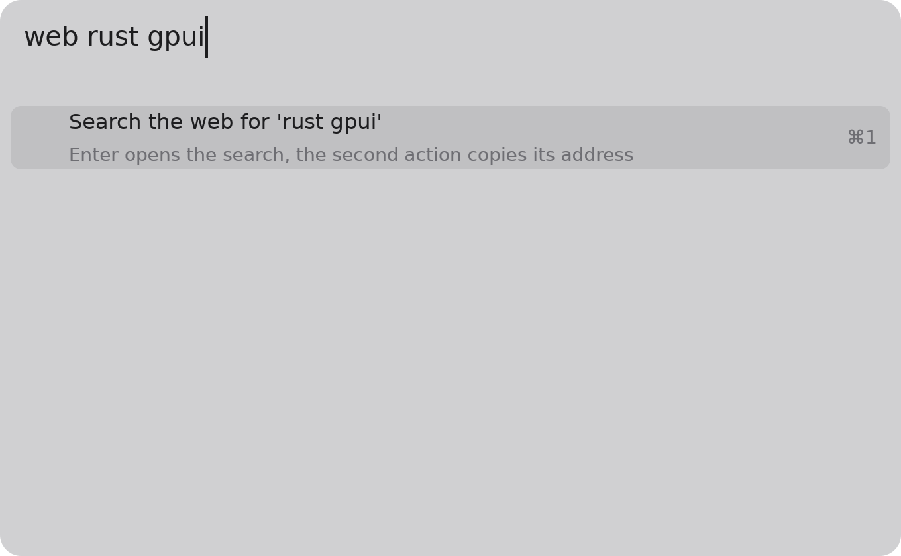
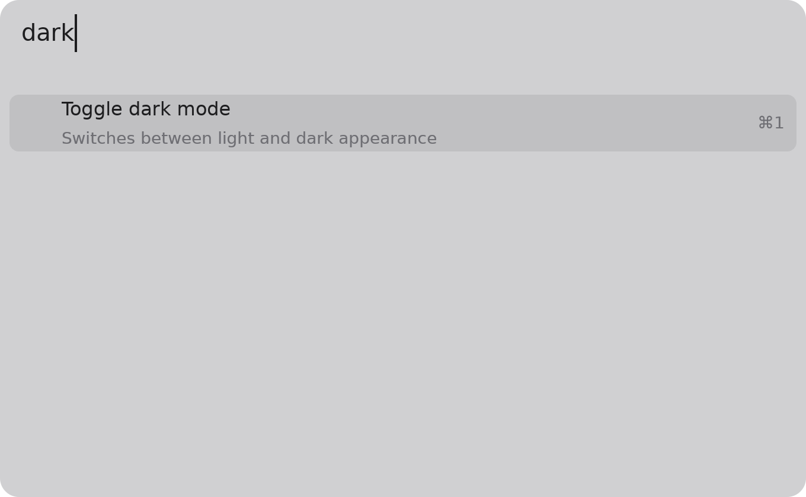
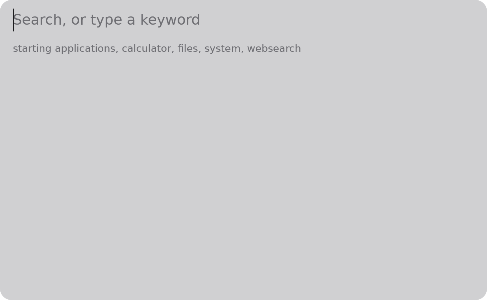

# Everyday use

{ width="640" }

## Keys

| Keys | What they do |
|---|---|
| ++option+space++ | Show the launcher, or hide it if it is showing |
| Typing | Asks every plugin that answers the text, as you type |
| ++up++ / ++down++ | Move the selection; the list scrolls past seven rows |
| ++enter++ | Run the selected row; on a suggestion row, fill it into the input |
| ++tab++ | Complete the selected row: put its completion in the input and keep going. Rows with no completion ignore it |
| ++cmd+1++ to ++cmd+9++ | Run the first to ninth row on screen |
| ++escape++ | Hide the launcher (or cancel what an input method is composing) |
| ++cmd+backspace++ | Delete everything before the cursor |
| ++option+backspace++ | Delete the word before the cursor |
| ++left++ / ++right++ | Move the cursor; with ++option++ a word at a time, with ++cmd++ to the start or end |
| ++shift++ with any of those | Select as the cursor moves |
| ++cmd+a++, ++cmd+c++, ++cmd+v++ | Select all, copy, paste |

The launcher hides itself when you click elsewhere.

## Keywords

Some plugins answer only when the text starts with their keyword, so they stay out of the
way otherwise: `web` searches the web, `f` finds files. Others answer anything they
understand: the applications plugin answers part of an app's name, the calculator answers
arithmetic, and the system plugin answers `sleep`, `lock`, `trash` and `dark`.

{ width="640" }

## The home list

With nothing typed, the launcher shows what moved while you were away: the newest five
notices that plugins sent (a watched ticket changing status, say), newest first, each with
the plugin's name and the notice's text under its title. Below them come any rows plugins
offer for an empty input. Press ++enter++ on a notice that has a link to open it; a notice
without one is only for reading. A notice that arrives while the list is showing joins it at
once, and typing replaces the whole list. The notices are kept in memory only: they are gone
when the app quits.

## The line under the input

A single line under the input says what is going on: a plugin's error, the background work
plugins report, which plugins are still answering, or which are still starting. When
several have something to say, the line shows the first of these:

1. A message: a plugin's error, or trouble starting plugins (in the warning colour).
2. A failed task, such as `vault: Saving capture failed`, also in the warning colour.
3. A running task, such as `search: Indexing notes 120/900`, with a detail after it when
   the plugin gives one and it fits. A task that finished shows for five seconds, then goes.
4. The plugins you are waiting on, or that are still starting.

With more than one task the line shows the most important and counts the rest: `+2`.
The line updates at most four times a second.

A failed task stays until you have seen it, and hiding the launcher dismisses it: it goes
when you hide the launcher after it was the text on the line, even if the launcher was up
for a moment. A failure behind a message, or counted in the `+N` behind another failure,
has not been seen: it stays and shows next time. There is no key for it, since the keys
the launcher owns are fixed (decision 4). A plugin that restarts or reloads takes its
tasks off the line; it reports them again if it still has them.

{ width="640" }

!!! abstract "To be written"
    Every key, mouse use, and what each message means. Tracked by the documentation epic
    (TASK-1.43).
